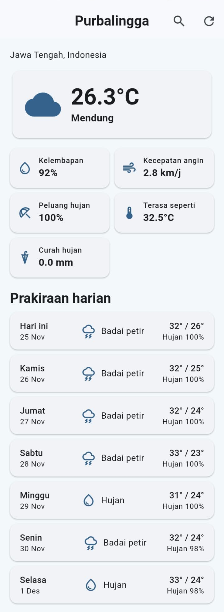
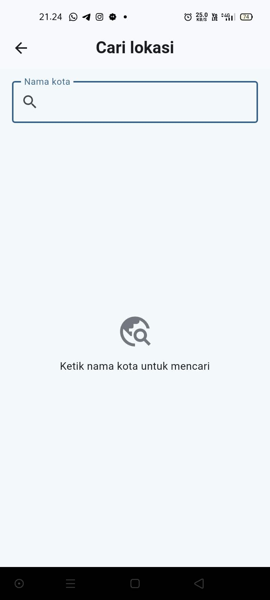

# Responsi Flutter – Aplikasi Cuaca

Aplikasi cuaca berbasis **Flutter (Dart)** dengan arsitektur **MVVM**. Seluruh data cuaca dan pencarian kota
diambil langsung dari **Open-Meteo REST API** (bukan data statis/hardcoded).

> Dokumentasi singkat (struktur aplikasi, implementasi API, penerapan MVVM): [`docs/DOKUMENTASI.md`](docs/DOKUMENTASI.md)

## Fitur

- **Home / Weather Screen**: nama kota terpilih, kondisi & suhu saat ini, kelembapan, kecepatan angin,
  peluang hujan, suhu terasa, curah hujan, dan prakiraan harian (7 hari).
- **Search / Location Screen**: input nama kota, daftar hasil pencarian, pilih lokasi untuk melihat cuaca,
  dan simpan lokasi sebagai favorit.
- Penyimpanan lokal (**SharedPreferences**): lokasi favorit dan lokasi terakhir dipilih, dimuat kembali saat aplikasi dibuka.
- Penanganan kondisi **loading**, **data kosong**, dan **error** (dengan tombol coba lagi).

## Teknologi

| Kebutuhan | Implementasi |
| --- | --- |
| Bahasa | Dart + Flutter, `StatelessWidget` & `StatefulWidget` |
| UI | Material 3, `ThemeData` terpusat (`core/theme/app_theme.dart`), typography via `TextTheme` |
| State management | `provider` (`ChangeNotifier`) |
| Networking | `http` (GET) ke Open-Meteo Geocoding & Forecast API |
| Local storage | `shared_preferences` |
| Arsitektur | MVVM |

## Cara Menjalankan

```bash
flutter pub get
flutter run
```

Pengujian dan analisis kode:

```bash
dart format lib test
flutter analyze
flutter test
```

## Screenshot

### Home / Weather Screen


### Search / Location Screen — Form Kosong


### Search / Location Screen — Mencari Kota


### Search / Location Screen — Favorit Aktif


## Video Penjelasan Kode

Link video: _(isi dengan link video penjelasan kode)_
