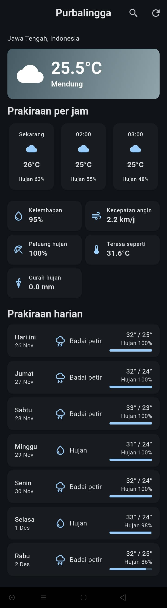
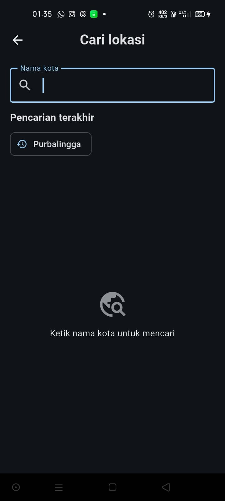
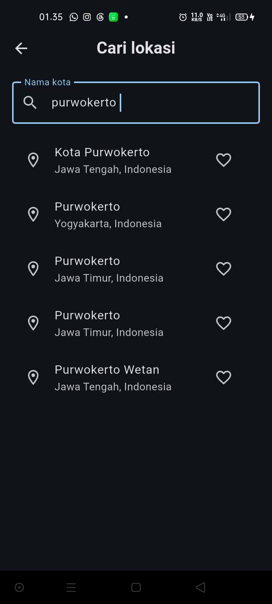
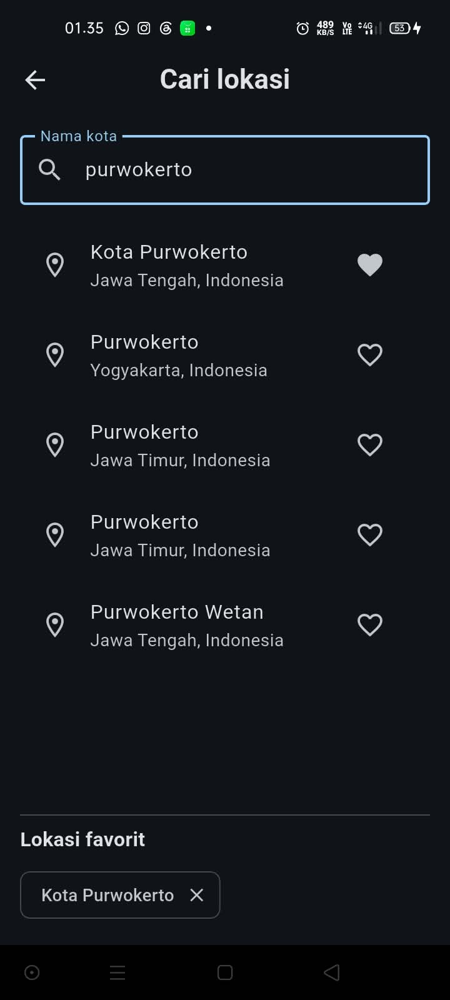

# Responsi Flutter – Aplikasi Cuaca

Aplikasi cuaca berbasis **Flutter (Dart)** dengan arsitektur **MVVM**. Seluruh data cuaca dan pencarian kota
diambil langsung dari **Open-Meteo REST API** (bukan data statis/hardcoded).

> Dokumentasi singkat (struktur aplikasi, implementasi API, penerapan MVVM): [`docs/DOKUMENTASI.md`](docs/DOKUMENTASI.md)

## Fitur

- **Home / Weather Screen**: nama kota terpilih, kondisi & suhu saat ini, kelembapan, kecepatan angin,
  peluang hujan, suhu terasa, curah hujan, forecast per jam (24 jam), dan prakiraan harian (7 hari).
- **Search / Location Screen**: input nama kota, daftar hasil pencarian, pilih lokasi untuk melihat cuaca,
  dan simpan lokasi sebagai favorit.
- Penyimpanan lokal (**SharedPreferences**): lokasi favorit, lima pencarian terakhir, dan lokasi terakhir dipilih; data dimuat kembali saat aplikasi dibuka.
- Penanganan kondisi **loading**, **data kosong**, dan **error** (dengan tombol coba lagi).

## Pengembangan Fitur Tambahan

Fitur berikut dikembangkan di luar kebutuhan minimum responsi untuk meningkatkan kualitas visual dan pengalaman penggunaan, tanpa menambah backend, chart kompleks, atau navigation tambahan.

### 1. Hero Card Dinamis

Kartu cuaca utama menggunakan gradient yang berubah berdasarkan `weather_code` dari Open-Meteo:

- Cerah menggunakan warna biru terang.
- Berawan menggunakan warna abu-biru.
- Hujan menggunakan warna biru.
- Badai menggunakan warna biru gelap.

Ikon, suhu, dan kondisi cuaca ditampilkan dengan kontras tinggi agar informasi utama mudah dibaca.

### 2. Mode Terang dan Gelap

Tampilan aplikasi otomatis mengikuti tema sistem operasi melalui `ThemeMode.system`. Saat tema perangkat berubah, Flutter memilih `ThemeData` terang atau gelap secara otomatis.

Implementasi menggunakan dua `ThemeData` terpusat:

- `appTheme()` untuk mode terang.
- `appDarkTheme()` untuk mode gelap.

### 3. Forecast Harian yang Lebih Informatif

Forecast harian diperjelas dengan beberapa informasi tambahan:

- Nama hari, seperti `Hari ini`, `Besok`, dan nama hari berikutnya.
- Suhu maksimum dan minimum.
- Ikon dan label kondisi cuaca.
- Progress bar peluang hujan.

Semua nilai tetap berasal dari data `daily` Open-Meteo, bukan data statis.

### 4. Forecast Per Jam

Home menampilkan forecast per jam untuk 24 jam ke depan dari field `hourly` Open-Meteo. Setiap kartu menampilkan waktu, suhu, ikon kondisi cuaca, dan peluang hujan.

### 5. Pencarian Terakhir

Lima lokasi terakhir yang dipilih disimpan dalam `SharedPreferences`. Lokasi tampil sebagai chip pada Search Screen dan dapat dipilih ulang tanpa mengetik nama kota.

### 6. Lokasi Terakhir

Lokasi terakhir yang dipilih otomatis disimpan dan dimuat saat aplikasi dibuka kembali. Aplikasi langsung mengambil data cuaca terbaru dari API untuk lokasi tersebut.

## Teknologi

| Kebutuhan | Implementasi |
| --- | --- |
| Bahasa | Dart + Flutter, `StatelessWidget` & `StatefulWidget` |
| UI | Material 3, `ThemeData` terpusat (`core/theme/app_theme.dart`), typography via `TextTheme` |
| State management | `provider` (`ChangeNotifier`) |
| Networking | `http` (GET) ke Open-Meteo Geocoding & Forecast API |
| Local storage | `shared_preferences` |
| Arsitektur | MVVM |

## Cara Menjalankan

```bash
flutter pub get
flutter run
```

Pengujian dan analisis kode:

```bash
dart format lib test
flutter analyze
flutter test
```

## Screenshot

### Home / Weather Screen


### Search / Location Screen — Form Kosong


### Search / Location Screen — Mencari Kota


### Search / Location Screen — Favorit Aktif


## Video Penjelasan Kode

Link video: https://youtu.be/1E_vXjdBsoE
